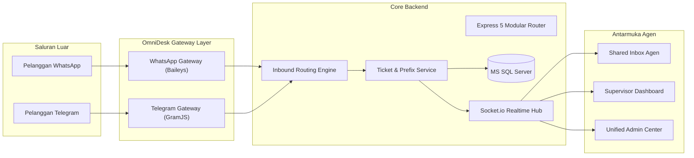

# OmniDesk - Enterprise Multi-Channel Customer Service Platform

<p align="center">
  
</p>

<p align="center">
  <strong>Platform Layanan Pelanggan Multi-Saluran (WhatsApp & Telegram) Berbasis Database Terpusat dengan Arsitektur Multi-Agent, Multi-Workspace, dan Dynamic Granular RBAC.</strong>
</p>

<p align="center">
  
  
  
  
  
  
</p>

---

## 📑 Daftar Isi
- [Tentang OmniDesk](#-tentang-omnidesk)
- [Fitur Utama](#-fitur-utama)
- [Arsitektur & Alur Sistem](#-arsitektur--alur-sistem)
- [Struktur Direktori Proyek](#-struktur-direktori-proyek)
- [Persyaratan Sistem](#-persyaratan-sistem)
- [Panduan Instalasi & Pengaturan](#-panduan-instalasi--pengaturan)
- [Akun Bawaan Sistem (Default Credentials)](#-akun-bawaan-sistem-default-credentials)
- [Menjalankan Aplikasi](#-menjalankan-aplikasi)
- [Pengujian Otomatis (Test Suite)](#-pengujian-otomatis-test-suite)
- [Referensi Endpoint API](#-referensi-endpoint-api)
- [Audit & Standar Keamanan Produksi](#-audit--standar-keamanan-produksi)

---

## 🌟 Tentang OmniDesk

**OmniDesk** adalah solusi *Customer Support Helpdesk* terintegrasi yang memungkinkan sebuah perusahaan mengoperasikan **1 nomor WhatsApp resmi** dan **1 akun Telegram resmi** secara bersamaan oleh **banyak agen customer service (Multi-Agent Shared Inbox)** tanpa bentrok sesi.

Sistem dirancang untuk skala enterprise dengan isolasi sesi, routing tiket per departemen/workspace, penyisipan identitas agen otomatis (*Dynamic Prefix Injection*), pengawasan supervisor secara *live* (*Whisper & Takeover*), serta perlindungan keamanan tingkat tinggi (*OWASP-hardened*).

---

## 🚀 Fitur Utama

### 1. Multi-Agent Shared Inbox
- **1 Akun Bersama**: 1 nomor WhatsApp dan 1 akun Telegram dapat melayani ribuan pesan masuk sekaligus dengan puluhan agen aktif bersamaan.
- **Antrean Klaim Tiket (Claim Pool)**: Tiket baru masuk ke *Unassigned Pool*. Agen mengklaim tiket secara mandiri untuk memulai penanganan.
- **Inisiasi Saluran Mandiri**: Mendukung pemindaian QR Code WhatsApp Multi-Perangkat langsung dari dashboard admin dan verifikasi Cloud 2FA untuk Telegram.

### 2. Dynamic Multi-Workspace (Departemen/Unit Fleksibel)
- **Manajemen Workspace**: Tambah, edit, dan kelola banyak Workspace (contoh: *Billing & Tagihan*, *Technical Support*, *Pengaduan Umum*).
- **Inbound Channel Routing**: Petakan nomor WhatsApp atau akun Telegram tertentu langsung ke Workspace tujuan secara otomatis.
- **Filter Header Dinamis**: Pemilih workspace di header atas seketika memfilter antrean tiket aktif sesuai departemen staf.
- **Penugasan Multi-Staf**: Agen dapat ditugaskan ke beberapa workspace sekaligus.

### 3. Granular RBAC & Dynamic Roles
- **Pembuatan Role Tanpa Batas**: Admin dapat membuat role baru (misal: `CS_FINANCE`, `LEAD_SPV`, `TECH_SUPPORT`).
- **Checklist Izin Granular**: Dikelompokkan ke ranah Operasional (`ticket_view`, `ticket_claim`, `ticket_reply`, `media_dispatch`, `ticket_resolve`), Supervisor (`whisper_internal`, `spv_takeover`, `spv_monitor`), dan Administrasi (`manage_users`, `manage_roles`, `manage_workspaces`, `manage_channels`).
- **Proteksi Role Sistem**: Tiga role inti (`ADMIN`, `SUPERVISOR`, `AGENT`) dilindungi secara permanen dari penghapusan tidak sengaja.

### 4. Dynamic Agent Prefix Injection
- **Penyisipan Otomatis**: Pesan keluar yang dikirim agen otomatis disisipi nama/alias resmi (contoh: `*[CS Budi]*: Halo, ada yang bisa dibantu?`).
- **Integritas Riwayat Pesan**: Teks internal dalam database tetap murni tanpa prefix, sehingga penggantian staf atau alih tiket tidak merusak format data obrolan.

### 5. Supervisor Operations (Pengawasan & Intervensi)
- **Live Eavesdropping**: Supervisor dapat melihat percakapan agen dengan pelanggan secara *real-time*.
- **Catatan Internal (Whisper Mode)**: Supervisor dapat memberikan instruksi rahasia yang hanya terlihat oleh tim internal.
- **Ticket Takeover**: Supervisor dapat mengambil alih tiket yang bermasalah atau mengalihkan ke agen lain.
- **Peringatan SLA Breach**: Otomatis mendeteksi tiket yang belum direspons lebih dari 5 menit (*First Response Time*).

### 6. Modern Clean UI & Multi-Theme Engine
- **3 Mode Tampilan**: Mode Terang (☀️), Mode Gelap (🌙), dan Mode Ikuti Sistem OS (🖥️).
- **6 Palet Aksen Dinamis**: Indigo Classic, Emerald Mint (nuansa WhatsApp), Ocean Azure, Royal Violet, Sunset Amber, dan Slate Minimal.
- **Live Instant Preview & FOUC-Free**: Pergantian warna seketika (*zero reload*) dengan preferensi tersimpan di `localStorage`.

---

## 🏛️ Arsitektur & Alur Sistem



---

## 📂 Struktur Direktori Proyek

```text
billing-omnichannel/
├── public/                     # Frontend Single Page Application (SPA)
│   ├── index.html              # Antarmuka utama modern (Tailwind + Lucide)
│   ├── app.js                  # Logika aplikasi client, WebSocket & Theme Engine
│   └── uploads/                # Direktori berkas terunggah (images & documents)
├── src/                        # Kode sumber backend (TypeScript)
│   ├── database/               # Koneksi MS SQL, schema DDL, dan seeder
│   │   ├── connection.ts       # Pool koneksi msnodesqlv8 / Windows ODBC
│   │   ├── schema.sql          # Skema tabel database relasional
│   │   └── seed.ts             # Data inisialisasi awal (User, Channel, SLA)
│   ├── middleware/             # Middleware keamanan produksi
│   │   ├── rate-limiter.ts     # Throttling request (Auth, Upload, Global API)
│   │   ├── upload.ts           # Multer whitelist, sanitasi UUID & filter MIME
│   │   └── error.middleware.ts # Centralized JSON error handler
│   ├── modules/                # Modul domain fungsional
│   │   ├── auth/               # Autentikasi JWT, password hashing & middleware RBAC
│   │   ├── billing/            # Integrasi pencarian tagihan pelanggan
│   │   ├── channels/           # Gateway WhatsApp & Telegram
│   │   ├── customers/          # CRM profil pelanggan & kontak divisi internal
│   │   ├── messages/           # Prefix injector service
│   │   ├── roles/              # Dynamic role service & granular permissions
│   │   ├── supervisor/         # Metrik monitoring supervisor & audit trail
│   │   ├── tickets/            # Layanan siklus hidup tiket, claim pool & obrolan
│   │   └── workspaces/         # Dynamic multi-workspace & inbound mapping
│   ├── realtime/               # WebSocket hub (Socket.io)
│   ├── routes/                 # Modular API Route Controllers
│   │   ├── auth.routes.ts      # Endpoint login, sesi, & CRUD pengguna
│   │   ├── ticket.routes.ts    # Endpoint klaim, pesan, media, & penyelesaian tiket
│   │   ├── workspace.routes.ts # Endpoint multi-workspace & penugasan staf
│   │   ├── role.routes.ts      # Endpoint role dinamis & checklist izin
│   │   ├── channel.routes.ts   # Endpoint saluran WhatsApp & Telegram
│   │   ├── supervisor.routes.ts# Endpoint metrik SPV & audit logs
│   │   ├── customer.routes.ts  # Endpoint data CRM & klasifikasi kontak
│   │   ├── billing.routes.ts   # Endpoint lookup tagihan
│   │   ├── simulator.routes.ts # Endpoint simulator pesan masuk (terproteksi)
│   │   └── index.ts            # Hub penggabung router modular
│   ├── routes.ts               # Re-export routes untuk backward compatibility
│   ├── server.ts               # Inisialisasi Express, Helmet, Socket, & Cron SLA
│   └── tests/                  # Automated Test Suites
│       ├── integration.test.ts # 77 uji fungsional integrasi end-to-end
│       └── security.test.ts    # 12 uji hardening keamanan produksi
├── .env.example                # Contoh variabel lingkungan
├── package.json                # Dependensi & skrip npm
├── tsconfig.json               # Konfigurasi TypeScript compiler
└── README.md                   # Dokumentasi resmi proyek
```

---

## 💻 Persyaratan Sistem

- **Node.js**: Versi `18.x`, `20.x`, atau yang lebih baru.
- **Sistem Operasi**: Windows 10/11 atau Windows Server (diperlukan untuk native ODBC Shared Memory/Named Pipes).
- **Database**: Microsoft SQL Server 2016+ (Local instance atau SQL Server Express `.\SQLEXPRESS`).
- **Driver Database**: [ODBC Driver 17 for SQL Server](https://learn.microsoft.com/en-us/sql/connect/odbc/download-odbc-driver-for-sql-server).

---

## ⚙️ Panduan Instalasi & Pengaturan

### 1. Salin Proyek & Masuk Direktori
```powershell
cd "c:\project-vibe-coding\billing omnichannel"
```

### 2. Pasang Dependensi
```powershell
npm install
```

### 3. Konfigurasi Lingkungan (`.env`)
Salin berkas `.env.example` menjadi `.env`:
```powershell
Copy-Item .env.example .env
```

Sesuaikan nilai di dalam `.env` jika diperlukan:
```env
PORT=3001
NODE_ENV=production
CORS_ORIGIN=*
JWT_SECRET=rahasia_jwt_super_aman_anda_ganti_di_produksi!

# Koneksi Microsoft SQL Server
MSSQL_CONNECTION_STRING=Driver={ODBC Driver 17 for SQL Server};Server=.\SQLEXPRESS;Database=BillingOmnichannel;Trusted_Connection=yes;

# Direktori Penyimpanan Sesi Saluran
WA_SESSION_DIR=./sessions/whatsapp
TG_SESSION_DIR=./sessions/telegram

# Kredensial API Telegram (Opsional, dari my.telegram.org)
TG_API_ID=2040
TG_API_HASH=b18441a1ff607e10a989891a5462e627
```

### 4. Inisialisasi Database & Seeding
Jalankan migrasi skema tabel dan data awal:
```powershell
npm run seed
```

---

## 🔑 Akun Bawaan Sistem (Default Credentials)

Setelah seeding dijalankan, sistem menyediakan akun siap pakai dengan berbagai level hak akses:

| Username | Password | Role | Peran / Hak Akses |
| :--- | :--- | :--- | :--- |
| `admin` | `Admin123!` | `ADMIN` | Akses penuh: Kelola Staf, Role Dinamis, Workspace, Saluran, & Monitor |
| `spv_dimas` | `Spv123!` | `SUPERVISOR` | Supervisor: Live Monitoring, Whispering, Takeover, & SLA Alert |
| `agent_budi` | `Agent123!` | `AGENT` | CS Agent: Klaim Tiket, Balas Percakapan, Kirim Media, Selesaikan Tiket |
| `agent_siti` | `Agent123!` | `AGENT` | CS Agent: Multi-Agent sesi terpisah |

---

## 🏃 Menjalankan Aplikasi

### Mode Pengembangan (Live Reload)
```powershell
npm run dev
```

### Mode Produksi
```powershell
npm start
```
Buka peramban dan akses: **`http://localhost:3001`**

---

## 🧪 Pengujian Otomatis (Test Suite)

OmniDesk dilengkapi dengan pengujian terotomatisasi menyeluruh untuk memastikan keandalan fungsional dan ketahanan keamanan:

Jalankan seluruh rangkaian uji:
```powershell
npm test
```

### Cakupan Pengujian (Total 89/89 Tests PASS - 100%):
1. **77 Uji Integrasi Fungsional (`src/tests/integration.test.ts`)**:
   - Konektivitas live database MS SQL.
   - Autentikasi JWT & Role-Based Access Control.
   - Pesan masuk & penempatan di Claim Pool.
   - Aksi klaim tiket & audit logging.
   - Dynamic Agent Prefix Injection.
   - Fitur bisikan supervisor (*Whisper*) & pengambilalihan tiket (*Takeover*).
   - Pengiriman media berkas & resolusi tiket.
   - Pembaruan profil CRM & klasifikasi kontak divisi internal.
   - Manajemen staf admin (tambah, nonaktifkan, aktivasi ulang, avatar).
   - Pembuatan Role Kustom Dinamis & proteksi role sistem.
   - Pembuatan Workspace Dinamis & penugasan staf multi-to-multi.
   - Routing otomatis saluran ke workspace tujuan (*Inbound Channel Routing*).
2. **12 Uji Keamanan Produksi (`src/tests/security.test.ts`)**:
   - Verifikasi header keamanan Helmet (`nosniff`, `SAMEORIGIN`, CSP).
   - Verifikasi probe kesehatan database (`/api/health`).
   - Proteksi akses simulator (blokir publik 401, blokir agen biasa 403, terima admin 200).
   - Validasi upload berkas & penolakan berkas berbahaya (`.html`, `.exe`).

---

## 📡 Referensi Endpoint API

Seluruh endpoint diawali dengan prefix `/api`:

### Autentikasi & Pengguna
- `POST /api/auth/login` - Masuk dan terima token JWT *(Rate-limited: 10x/15mnt)*
- `GET /api/auth/me` - Ambil profil pengguna yang sedang login
- `GET /api/auth/users` - Ambil daftar pengguna (Admin & SPV)
- `POST /api/admin/users` - Tambah pengguna baru (Admin)
- `PUT /api/admin/users/:id` - Perbarui profil/password pengguna (Admin)
- `PATCH /api/admin/users/:id/status` - Aktifkan/nonaktifkan akun (Admin)
- `POST /api/admin/users/:id/avatar` - Unggah avatar pengguna *(Max 2MB, JPG/PNG/WEBP)*

### Manajemen Tiket
- `GET /api/tickets/pool` - Ambil tiket di antrean belum diklaim (filter by `workspace_id`)
- `GET /api/tickets/my` - Ambil tiket yang sedang ditangani agen yang login
- `GET /api/tickets/all` - Ambil seluruh tiket sistem (Admin & SPV)
- `GET /api/tickets/:id` - Ambil detail lengkap tiket dan riwayat obrolan
- `POST /api/tickets/:id/claim` - Klaim tiket dari antrean
- `POST /api/tickets/:id/reply` - Balas percakapan tiket (otomatis disisipi prefix)
- `POST /api/tickets/:id/reply-media` - Kirim media/dokumen ke pelanggan *(Max 15MB)*
- `POST /api/tickets/:id/note` - Tambahkan catatan rahasia internal (*Whisper*)
- `POST /api/tickets/:id/takeover` - Ambil alih/alihkan tiket ke staf lain
- `POST /api/tickets/:id/resolve` - Selesaikan dan tutup tiket

### Manajemen Workspace & Role
- `GET /api/workspaces/my` - Ambil daftar workspace milik pengguna aktif
- `GET /api/admin/workspaces` - Ambil seluruh data workspace (Admin & SPV)
- `POST /api/admin/workspaces` - Buat workspace baru (Admin)
- `PUT /api/admin/workspaces/:id` - Perbarui data/warna workspace (Admin)
- `DELETE /api/admin/workspaces/:id` - Hapus workspace (Admin)
- `GET /api/admin/roles` - Ambil daftar role dan hak akses
- `POST /api/admin/roles` - Buat role baru dengan checklist izin granular (Admin)
- `PUT /api/admin/roles/:id` - Perbarui nama/izin role (Admin)
- `DELETE /api/admin/roles/:id` - Hapus role non-sistem (Admin)

### Saluran & Pengawasan
- `GET /api/channels` - Daftar saluran aktif dan status koneksi
- `POST /api/admin/channels/whatsapp` - Daftarkan koneksi nomor WhatsApp baru
- `POST /api/channels/:id/prefix-config` - Ubah template prefix nama agen saluran
- `GET /api/supervisor/overview` - Metrik performa dan beban kerja staf
- `GET /api/supervisor/audit-logs` - Riwayat log aktivitas operasional audit trail
- `POST /api/simulator/inbound` - Simulator chat masuk *(Khusus Admin/Supervisor)*

---

## 🛡️ Audit & Standar Keamanan Produksi

OmniDesk telah menerapkan praktik keamanan standar industri:

1. **Anti SQL Injection**: 100% kueri database menggunakan *parameterized inputs* (`@param`). Tidak ada penggabungan string (*string concatenation*).
2. **Anti Brute-Force**: Pembatasan percobaan login pada layer middleware IP untuk mencegah serangan penebakan kata sandi.
3. **Anti Stored / DOM XSS**: Semua input teks dan rendering tabel frontend disanitasi menggunakan pembersihan entitas HTML (`escapeHtml`).
4. **Strict File Upload Protection**: Validasi ganda tipe MIME berkas, pemblokiran ekstensi eksekutabel/skrip, serta pengubahan nama berkas dengan UUID acak.
5. **Least Privilege RBAC**: Setiap endpoint sensitif dilindungi middleware izin granular (`permissionMiddleware`).
6. **Graceful Shutdown**: Menutup koneksi database dan proses background secara tertib saat server menerima sinyal *restart* atau *deploy*.

---

<p align="center">
  Dibuat dengan ❤️ untuk Solusi Layanan Pelanggan Omni-Channel Indonesia Berkualitas Tinggi.
</p>
